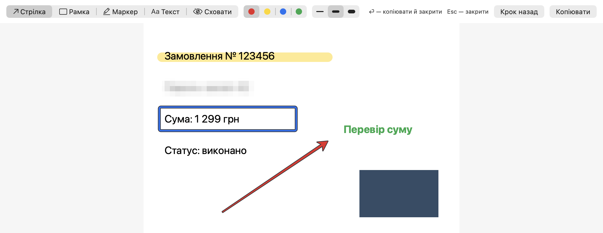

# Помітка

Безкоштовна програма для macOS, щоб розмічати скріни. Робиш знімок через ⌘⇧4, і він одразу відкривається
у вікні розмітки. Там можна намалювати стрілку, рамку, провести маркером, написати текст або сховати пароль.
Натискаєш Enter, і картинка опиняється в буфері: вставляй її в чат через ⌘V.

*A free screenshot markup tool for macOS: take a shot with ⌘⇧4 and annotate it right away — arrows, boxes,
highlighter, text, pixelate. Press Enter and paste it anywhere. Interface in Ukrainian.*



## Встановлення

1. Завантаж `Pomitka-1.0.0.zip` зі сторінки [Releases](https://github.com/etuhvatullin/pomitka/releases/latest).
2. Відкрий архів подвійним кліком і перетягни програму `Pomitka` у теку «Програми».
3. Запусти Помітку. macOS скаже, що не може перевірити програму. Так буває, бо програма не підписана
   платним сертифікатом Apple. Натисни «Готово», а не «Перемістити в Кошик».
4. Відкрий «Системні параметри → Конфіденційність і безпека» і прокрути донизу. Біля «Pomitka» натисни
   кнопку «Все одно відкрити» (англійською — *Open Anyway*) і підтверди паролем.
5. Помітка спитає, чи налаштувати знімки. Натисни «Налаштувати».

Після цього у рядку меню вгорі зʼявиться значок олівця. Помітка запускатиметься сама під час входу в систему.

Якщо ти вмієш користуватися Терміналом, кроки 3–4 можна замінити однією командою:

```sh
xattr -dr com.apple.quarantine /Applications/Pomitka.app
```

## Як користуватися

Зроби знімок через **⌘⇧4** і виділи область. Вікно розмітки відкриється само.

| Що | Як |
|---|---|
| Стрілка, рамка, маркер, текст, сховати | кнопки вгорі або клавіші **1–5** |
| Колір | спершу вибери інструмент, потім кружечок кольору; кожен інструмент запамʼятовує свій колір |
| Товщина | три риски вгорі або клавіші **[** і **]** |
| Рівна смуга маркером | тримай **Shift** |
| Прибрати останню позначку | **⌘Z** |
| Скопіювати й закрити | **Enter** або **⌘C** |
| Закрити без копіювання | **Esc** |

Знімок через ⌃⌘⇧4 (з Control) macOS кладе одразу в буфер, а не у файл, тому Помітка сама його не відкриє.
Такий знімок теж можна розмітити: значок олівця → «Розмітити картинку з буфера».

## Що Помітка змінює в системі

- **Налаштування знімків, лише з твоєї згоди.** Знімки зберігаються в теці `~/Знімки`, бо робочий стіл
  і «Документи» macOS закриває від програм. Мініатюра в кутку вимикається, бо з нею macOS записує файл
  лише через кілька секунд. Повернути все як було можна в меню олівця: «Повернути налаштування знімків».
- **Запуск під час входу в систему.** Вимикається в меню олівця.

Помітка нічого не надсилає в мережу. Доступу до екрана в неї немає: знімок робить сама macOS, а Помітка
лише відкриває готовий файл. Розмічена картинка потрапляє тільки в буфер обміну.

## Вимоги

macOS 13 або новіша, Mac на Apple Silicon або Intel.

## Зібрати самому

Потрібні Command Line Tools (`xcode-select --install`). Повний Xcode не потрібен.

```sh
./build.sh install   # перевірка, збирання, встановлення в ~/Applications і запуск
./build.sh dist      # архів для завантаження в dist/
```

Перевірка малює всі позначки на штучному знімку (`build/sample.png`) і саме вікно (`build/window.png`),
тож результат можна подивитися без екрана.

## Ліцензія

[MIT](LICENSE)
